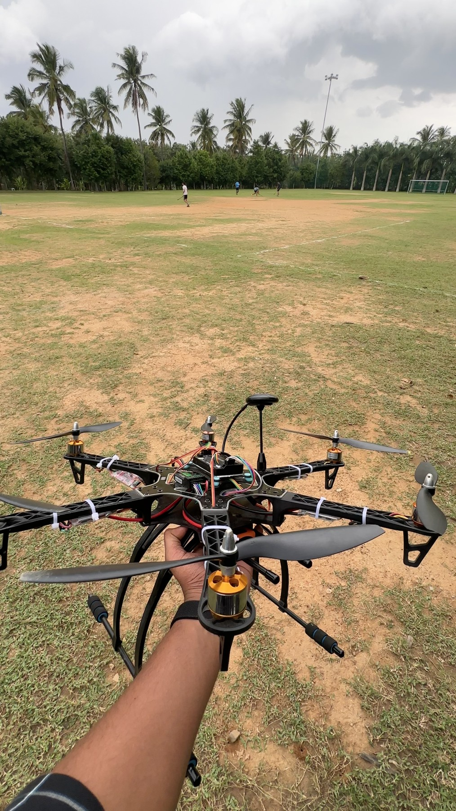
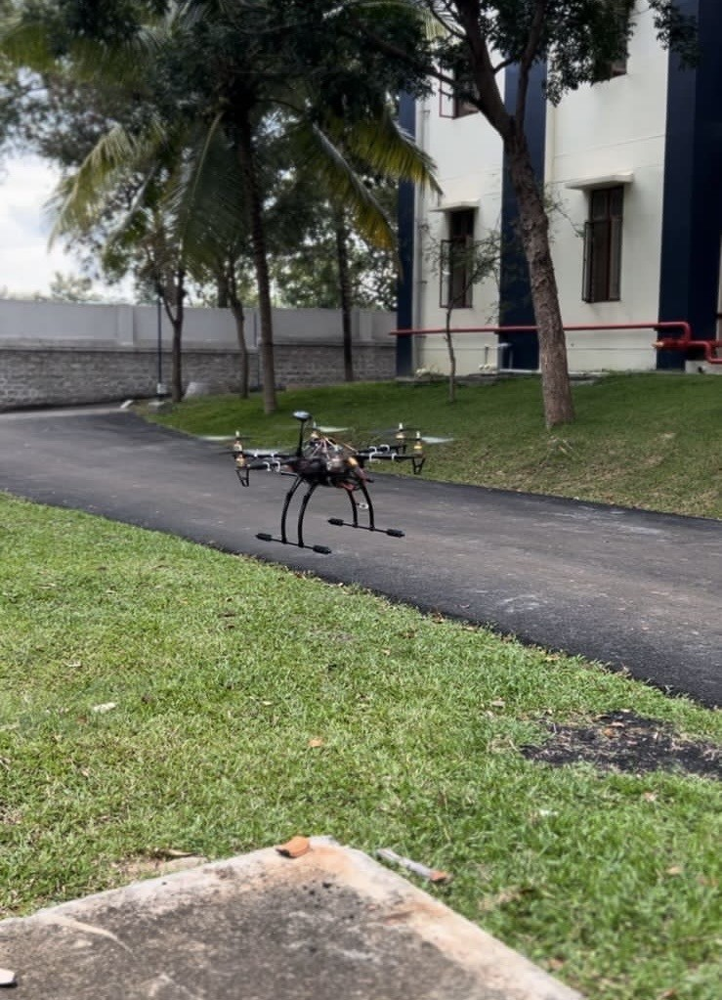
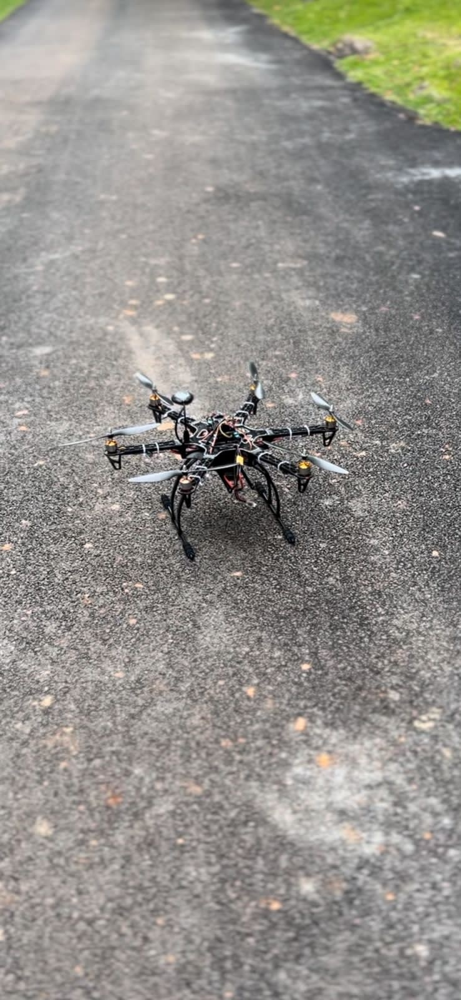
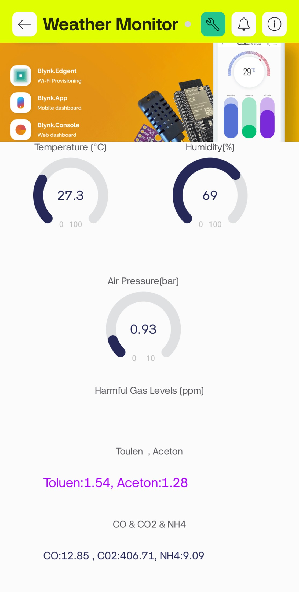

# Environmental Monitoring Hexacopter

**A manually piloted hexacopter carrying an ESP8266 sensor payload that sends environmental readings to the Blynk app during flight.**

**Thiruppathi P**  
**Status:** Built and flown with in-flight Blynk data transmission.

## Overview

This project combines a six-motor UAV with an IoT sensing payload to observe temperature, humidity, atmospheric pressure, and an MQ135 gas-sensor response from an airborne platform. Mission Planner was used for flight-controller setup, and the aircraft was flown manually. The ESP8266 handles sensor acquisition and Wi-Fi communication with Blynk.

## My contribution

- Led the project team.
- Assembled the hexacopter and completed electrical wiring.
- Set up the flight controller using Mission Planner.
- Programmed the environmental sensing payload.
- Configured the Blynk dashboard.
- Worked on the drone CAD design.

## Hardware and software

| Subsystem | Components |
|---|---|
| Flight controller | APM 2.8 |
| Propulsion | Six 1000 KV motors, 10-inch propellers, 30 A ESCs |
| Battery | 5200 mAh, 3S LiPo |
| Radio control | FlySky FS-i6 transmitter and receiver system |
| Sensor controller | ESP8266 |
| Temperature and humidity | DHT22 |
| Atmospheric pressure | BMP280, I2C address `0x76` |
| Gas sensing | MQ135 connected to analog input A0 in the sketch |
| Flight setup | Mission Planner |
| Remote dashboard | Blynk |

## Working principle

The pilot controls the hexacopter through the radio system and APM flight controller. Separately, the ESP8266 reads the DHT22, BMP280 and MQ135, then publishes values over Wi-Fi to Blynk virtual pins. The mobile dashboard displays the incoming data during flight.

| Blynk pin | Value sent by the original sketch |
|---|---|
| V0 | Temperature in degrees Celsius |
| V1 | Relative humidity in percent |
| V2 | Atmospheric pressure in bar |
| V3 | Text containing CO, CO2 and `NH4` model outputs |
| V4 | Text containing toluene and acetone model outputs |

The MQ135 values are outputs of different curve models applied to the same sensor signal. They are presented as experimental gas-response estimates, not independently measured concentrations of multiple gases.

## Build and flight photographs

*Hexacopter airborne during outdoor testing.*

*Assembled aircraft with six arms and landing gear.*

## Dashboard and CAD

*Environmental monitoring dashboard. Virtual-pin assignments are documented in the source sketch.*

See the [CAD screenshot gallery](docs/cad-gallery.md) for seven views of the hexacopter design.

## Results

- Assembled and manually flew the hexacopter.
- Integrated an ESP8266 environmental sensing payload.
- Sent sensor readings to Blynk during flight.

## Repository guide

- [Original sensor sketch, sanitized](firmware/original_environment_monitor/original_environment_monitor.ino)
- [Code review](docs/code-review.md)
- [Sensor connections and Blynk setup](docs/setup.md)
- [Revised project report](reports/environmental-monitoring-report.md)
- [Media provenance](docs/media-record.md)
- [Suggested GitHub description and topics](docs/repository-details.md)

The project source uses credential placeholders and cleaned-up formatting and comments. Read the code review before attempting to compile or reuse it.
